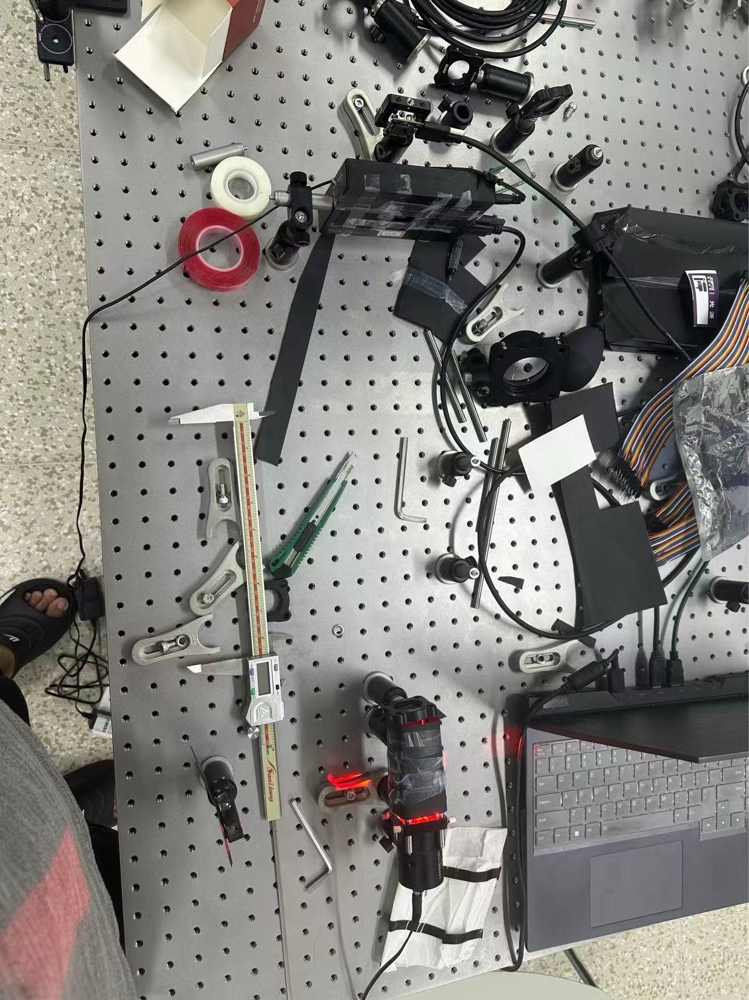

# SLM 定制散斑与 PSF 反卷积 — 2026-11-24

大恒 GCI-770202 相位 SLM（1024×768，p = 18 µm，620 nm 下行程 1.29π）上的图案设计、散斑实测与反卷积实验。

> 工具链与更早的实验记录见主仓库 [summit-leen/slm-lab](https://github.com/summit-leen/slm-lab)。
> 光路、器件清单、有效性判据与主仓库 `docs/` 保持一致。



---

## 这一天做了什么

| 部分 | 内容 |
| --- | --- |
| 图案 A/B/C | 微透镜阵列的三种形态，比较 PSF 反卷积的可实现性 |
| 重现 | A/B/C 的散斑帧 + 同一流程的反卷积对照 |
| 图案 W1/W2/W3 | 相位编码器，把散斑"塑形"成条纹 / 圆环 / 水波 |
| 图案 D/E | 纯相位 diffuser（逐像素 / 4×4 块）—— **未成功**，文档给出原理。

完整图文见 [`docs/2026-11-24-定制散斑与PSF反卷积.md`](docs/2026-11-24-定制散斑与PSF反卷积.md)。

---

## 目录

```
.
├── README.md
├── docs/
│   ├── 2026-11-24-定制散斑与PSF反卷积.md   ← 主文档（17 张图）
│   ├── opt_setup_20261124.jpg               ← 光路实拍
│   └── VERSIONS.md                          ← 图案版本登记表
├── patterns/                                ← 6 张相位图案（PNG，1024×768）
├── captures/                                ← 实测帧与重建结果（JPEG）
└── code/                                    ← 生成与重建脚本
```

---

## 图案一览

| 版本 | 类型 | 参数 | 文件 |
| --- | --- | --- | --- |
| **A** | 420 枚多带透镜 + 随机相位背景 | f 30–50 mm，口径 0.32–1.56 mm，覆盖 50.4% | `patterns/A_rla420_hyb_phase.png` |
| **B** | 420 枚多带透镜，黑底 | 同上，无背景噪声 | `patterns/B_rla420_phase.png` |
| **C** | 150 枚**单带**透镜，随机位置 | 口径 0.19–0.25 mm，艾里 68 µm | `patterns/C_onezone_rand_phase.png` |
| **W1** | 一维随机相位 | φ = 2π·u(x) | `patterns/W1_phase.png` |
| **W2** | 轴棱锥 | Λ = 40 µm → 环半径 0.78 mm | `patterns/W2_phase.png` |
| **W3** | Kolmogorov 相位屏 | PSD ∝ f^(−11/3)，f₀ = 0.01 | `patterns/W3_phase.png` |
| **D** | 逐像素随机相位（diffuser） | 自相关 1 px | `patterns/D_rand_phase.png` |
| **E** | 4×4 块随机相位 | 有效单元 72 µm，散射 ±4.3 mrad | `patterns/E_rand_b4_phase.png` |

## 关键结果

| 版本 | 反卷积（2 mm 三角孔） | 判定 |
| --- | --- | --- |
| **C** | 边缘 10–90%：**229 → 15 px（15×）** | ✅ 唯一完整闭环 |
| **B** | 19 → 8 px，但碎成几段 | ⚠️ 多带 PSF 振铃 |
| **A** | 179 → 85 px，仍是一团 | ❌ 随机背景是纯干扰 |
| **D** | 四种方法全部塌成 delta | ❌ 支撑 7.7 mm ≫ 物 2 mm |
| **E** | 残差卡在 0.71，收敛成亮团 | ❌ 同上，加粗块只提高对比度 |

两条判据（详见文档第四部分）：

1. **PSF 支撑 / 物尺寸 ≪ 1** 才能反卷积（C = 0.04，纯 diffuser 是 3.9）
2. **相干照明下 $I=|o\circledast h|^2$**，不能做强度反卷积；C 靠几何聚焦把非线性局部化才成立

## 复现

```bash
# 生成图案
python code/random_lens_array.py --n 420 --seed 20261123 --save patterns/A_rla420
python code/onezone_array.py --n 150 --layout random --seed 20261123 --save patterns/C_onezone_rand
python code/wave_patterns.py --which all --save-prefix patterns/

# 上屏
python code/slm_show.py --file patterns/C_onezone_rand_phase.png --hold 0

# 采集
python code/cam_stack.py --exp 80000 --n 16 --out captures/xxx
```

## 许可

实验室内部使用。
