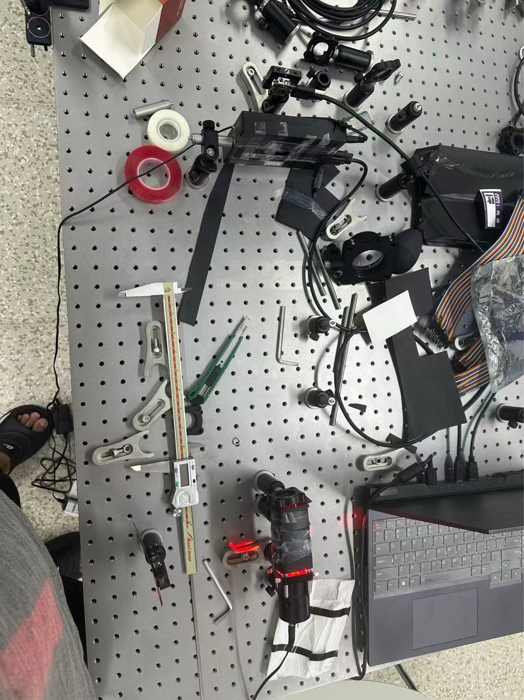

# 2026-11-24 工作总结：定制散斑图案与 PSF 反卷积

> 设备：大恒 GCI-770202 液晶相位 SLM（1024×768，p = 18 µm，620 nm 下行程 1.29π）
> 相机：Basler daA3840-45um（3860×2178，2 µm/px，靶面 7.72×4.36 mm）
> 光路：LED → 针孔/物卡 → SLM → 50 mm → 相机（无成像镜头、无检偏器）

---

## 光路实物



| 环节 | 说明 |
| --- | --- |
| 光源 | 红色 LED（620 nm），出口自带准直透镜 |
| 针孔 / 物卡 | Ø100 µm 针孔（标定 PSF 用）或 2 mm 三角孔物卡（拍物帧用），两者交替放置 |
| SLM | 大恒 GCI-770202，1024×768，黑色面板，HDMI 作第二显示器 |
| 相机 | Basler daA3840-45um，面板后 50 mm，无成像镜头 |
| 基准 | 全部器件固定在光学平板上，间距用卡尺实测——针孔/物卡的位置是重建成败的关键 |

---

## 第一部分：三个核心图案 A / B / C

三个图案都是「微透镜阵列」的不同形态，用来比较 **PSF 反卷积**的可实现性。

### A — 420 枚多带透镜 + 全幅随机相位背景


| 项 | 值 |
| --- | --- |
| 透镜 | 420 枚，位置随机（RSA），焦距 30–50 mm 各自独立 |
| 口径 | 0.32–1.56 mm |
| 环数 | 0.4–10.2 个菲涅尔带（多带） |
| 背景 | 空白区填 0–255 随机相位（产生散斑） |
| 覆盖 | 50.4% |
| 文件 | `patterns/A_rla420_hyb_phase.npy` |

**实测散斑帧**（物卡直照，50 ms × 12）：


σ/μ = 0.136，max = 87.4 —— 背景散斑把结构对比度稀释了 22%。

---

### B — 420 枚多带透镜，黑底（无背景噪声）


| 项 | 值 |
| --- | --- |
| 透镜 | 420 枚，焦距 30.0–50.0 mm |
| 口径 | 0.32–1.56 mm（随 f 联动，保证不混叠） |
| 环数 | 0.4–10.2 |
| 覆盖 | **50.4%**（黑底，其余 gray=0 不调制） |
| 文件 | `patterns/B_rla420_phase.npy`（sha16 `cd946d082f82244e`） |

**实测帧**（针孔标定，80 ms × 16）：


σ/μ = 0.174 —— 比 A 高 28%，因为去掉了散斑背景。

---

### C — 150 枚单带透镜，随机位置（**唯一成功闭环的版本**）


| 项 | 值 |
| --- | --- |
| 透镜 | **150 枚**，随机位置 |
| 焦距 | 30.06–49.97 mm |
| 口径 | 0.19–0.25 mm（单带 → `f = r²/2λ` 把口径钉死） |
| 环数 | **1 个**（只保留中心圆） |
| 覆盖 | 9.1% |
| 艾里半径 | 59–76 µm（中位 68） |
| 文件 | `patterns/C_onezone_rand_phase.npy`（sha16 `7efaf3b7cfa75893`） |

**实测 PSF 帧**（针孔，80 ms × 16）：139 个亮斑（150 枚的 93%），核 FWHM 中位 82 µm。


---

## 第二部分：重建效果

### C（成功）

同一几何下拍 PSF（针孔）与物帧（2 mm 三角孔），局部实测核 + Richardson–Lucy 反卷积：


| 指标 | 数值 |
| --- | --- |
| 中心行 10–90% 边缘宽度 | **229 px → 15 px（改善 15 倍）** |
| 三角 50% 弦长 | 154 µm → 50 µm |
| 边缘对比度 | 0.95 |

边缘图（|∇x̂|）里三角形的三条边完全分离：


### 三版对照（同一套流程、同一归一化）


| 版本 | 边缘 10–90% | HP std（y → x̂） | 形态 | 判定 |
| --- | --- | --- | --- | --- |
| **C** 单带 150 枚 | 36 → **17 px** | 0.028 → 0.094 | 完整三角形 | ✅ 最好 |
| **B** 多带 420 枚 | 19 → **8 px** | 0.049 → 0.129 | 碎成几段 + 亮弧 | ⚠️ 振铃 |
| **A** 多带 + 噪声背景 | 179 → **85 px** | 0.023 → 0.040 | 仍是一团模糊 | ❌ 最差 |

**结论**：① 标定与物帧必须**几何一致**（B 第一次失败就是因为 h 在 400 mm、y 在 217 mm）；② 单带 PSF 无同心环旁瓣，RL 不振铃；③ 随机相位背景是纯干扰。

---

## 第三部分：定制散斑形状 W1 / W2 / W3

> 与 A/B/C 不同，这三个图案不是透镜，而是**相位编码器**：通过给相位加定向空间相关或确定性载频，让散斑从「颗粒」变成条纹 / 圆环 / 水波。

### W1 — 一维随机相位 → 竖直条纹


$$\varphi(x,y)=2\pi\,u(x)\quad(u\text{ 每列一个随机值，沿 }y\text{ 恒定})$$


| 指标 | 值 |
| --- | --- |
| 条纹宽度 | ~11 px ≈ 22 µm |
| σ/μ | 0.189 |
| 高通细节 HP | 3.88 |

---

### W2 — 轴棱锥（锥面相位）→ 同心圆环


$$\varphi=-\frac{2\pi r}{\Lambda},\qquad \Lambda=40\ \mu m,\qquad R=\frac{s\lambda}{\Lambda}=0.78\ \text{mm}$$


| 指标 | 值 |
| --- | --- |
| 远场环半径 | 0.78 mm（设计值） |
| 相关长度 | 5 px |
| σ/μ | 0.122 |

> 注意：随机抖动必须 ≤0.15π。第一次用 1.0π 抖动时环被打散成均匀颗粒，看不出圆环。

---

### W3 — Kolmogorov 相位屏 → 水波


$$S_\varphi(f)=\Big(\frac{f}{f_0}\Big)^{-11/3}\ \ (f_0=0.01),\qquad \varphi=\mathcal{F}^{-1}\big[\sqrt{S_\varphi}\,\mathcal{N}(0,1)\big]$$


| 指标 | 值 |
| --- | --- |
| 形态 | 大尺度涟漪 + 细纹 |
| σ/μ | 0.054 |
| 高通细节 HP | 3.72 |

---

### 三张对照


| 版本 | 相位写法 | 实测形态 | σ/μ |
| --- | --- | --- | --- |
| **W1** | 一维随机 | 竖直条纹 | 0.189 |
| **W2** | 轴棱锥 | 同心圆环 + 星芒 | 0.122 |
| **W3** | Kolmogorov | 水波/涟漪 | 0.054 |

生成器：`code/wave_patterns.py`

```bash
python code/wave_patterns.py --which all --save-prefix patterns/   # 生成三张
python code/wave_patterns.py --which W2 --ring-mm 0.5 --jitter 0.15 --save-prefix patterns/
```

---

## 第四部分：D / E —— 纯相位 diffuser 的失败与判据

A/B/C 是「透镜阵列」，D/E 是「纯相位散射体」。后者看起来很诱人（全局编码），但在本设备上**失败**，原因非常明确。

### D — 逐像素均匀随机相位


| 项 | 值 |
| --- | --- |
| 分布 | 逐像素均匀随机（自相关 1 px） |
| 均值 / std | 127.52 / 73.98 |
| 相位行程 | 0–4.05 rad（=1.29π） |
| 文件 | `patterns/D_rand_phase.npy`（sha16 `e2e90dd1d7eacfa3`） |

**PSF 帧**（针孔，80 ms × 16）：


σ/μ = 0.135，颗粒 14 µm。

**物帧与反卷积**：


四种方法**全部塌缩成一个 delta 点**，没有恢复出三角形。

---

### E — 4×4 块随机相位


| 项 | 值 |
| --- | --- |
| 块大小 | 4×4 像素（有效单元 72 µm） |
| 散射半角 | 4.3 mrad（D 是 17.2 mrad） |
| s=50 mm 处扩散 | 0.43 mm |
| 文件 | `patterns/E_rand_b4_phase.npy`（sha16 `4cca4775be15eca3`） |

加粗块把对比度从 D 的 0.135 提到 **0.216**（颗粒 46 µm，推算照明斑 0.67 mm）：


但物帧与反卷积仍然失败——RL 残差从 0.711 到 0.710，几乎不下降，结果是一个亮团：


---

### 为什么必然失败

反卷积要求 **h 的支撑 ≪ 物尺寸**：

| 版本 | PSF 支撑 | 物 2 mm | 比值 |
| --- | --- | --- | --- |
| C（单带透镜） | 82 µm | 2000 µm | **0.04** ✅ |
| B（多带透镜） | 46 µm | 2000 µm | 0.02 ⚠️ 振铃 |
| **D（diffuser）** | **≈7.7 mm（靶面限）** | 2000 µm | **3.9** ❌ |
| E（4×4 块） | 0.67 mm + 杂散光 | 2000 µm | 0.34 ⚠️ 但仍失败 |

更根本的一条是**相干性**：相干照明下真实模型是

$$I=\left|o\circledast h\right|^{2}$$

先卷积、再取模平方，**不是强度的线性卷积**。RL/Wiener 假设 $I=|o|^2\circledast|h|^2$，模型本身不成立，所以残差卡死、结果塌缩。

C 之所以能成功，是因为透镜的**几何聚焦**把非线性局部化了：每枚透镜成一个小像、核 82 µm ≪ 物，交叉项可忽略，强度卷积近似成立。

> 结论：在这台设备上做 2 mm 级单帧反卷积成像，**必须用单带透镜阵列（C），不能用 diffuser（D/E）**。要用 diffuser 需要改光源（非相干）或改用相位恢复算法。


### 未成功的项：逐条说明可能原理

| 版本 | 环节 | 未成功的可能原因 |
| --- | --- | --- |
| **A** | 反卷积 | ① 随机相位背景是**未建模的随机项**，被 RL 当成信号拟合；② 多带 PSF 有同心环旁瓣 → 振铃；③ 反卷积前未做几何一致性校验 |
| **B** | 反卷积（第一次） | **标定帧与物帧不共几何**（h 在 400 mm、y 在 217 mm）→ 拿错核去卷积，只放大噪声 |
| **B** | 反卷积（第二次，同几何） | 几何对了，但**多带透镜的 PSF 有同心环**，RL 对旁瓣敏感 → 振铃、碎块 |
| **D** | 反卷积 | ① PSF 支撑 ≈7.7 mm（被靶面限）> 物 2 mm；② **相干照明下模型是 $I=|o\circledast h|^2$**，不是强度线性卷积 |
| **E** | 反卷积 | 同上；加粗块只把对比度从 0.135 提到 0.216，**没有改变模型的非线性**；且面板有未调制的宽角杂散光 |
| **W1/W2/W3** | 用作成像编码器 | 它们是确定性衍射元件（条纹/环/水波），**相位不含随机性**，编码矩阵秩低、不能支持反演；只适合"塑形散斑"，不适合成像 |

### 这一条最关键

> **相干光 + 相位编码 ⇒ 线性强度反卷积不成立。**
> 这条判据解释了 A/B/D/E 的全部失败；C 能成功，是因为透镜的几何聚焦把非线性局部化了。

下图是当时的实际光路（LED → 针孔/物卡 → SLM → 相机，全部固定在光学平板上）。针孔与物卡的**交替放置**和**间距**直接决定了 h 与 y 是否共几何——这是 B 第一次失败的直接原因。


---

## 第五部分：关键判据与结论

### 1. PSF 支撑判据（决定反卷积能否成功）

$$\frac{\text{PSF 支撑}}{\text{物尺寸}}\ll 1$$

| 版本 | PSF 支撑 | 物 2 mm | 比值 | 能否反卷积 |
| --- | --- | --- | --- | --- |
| C | 82 µm | 2000 µm | **0.04** | ✅ |
| B | 46 µm（带环） | 2000 µm | 0.02 | ⚠️ 有振铃 |
| D（纯随机相位） | ≈7.7 mm（靶面限） | 2000 µm | **3.9** | ❌ |

### 2. 相干性判据（决定能不能用强度反卷积）

| 照明 | 模型 | 能否强度反卷积 |
| --- | --- | --- |
| **相干**（点源） | $I=\left|o\circledast h\right|^2$ | ❌ 非线性 |
| **非相干**（扩展源） | $I=|o|^2\circledast|h|^2$ | ✅ |

这就是 D/E（diffuser）反复失败的根本原因：要它编码必须相干，一旦相干就不能做强度反卷积。

**C 之所以成功**：透镜的**几何聚焦**把非线性局部化——每枚透镜成一个小像、核 82 µm ≪ 物，干涉交叉项可忽略，强度卷积近似成立。

### 3. 今日产出清单

| 类别 | 文件 |
| --- | --- |
| 图案 A/B/C | `patterns/{A_rla420_hyb,B_rla420,C_onezone_rand}_phase.npy` |
| 图案 W1/W2/W3 | `patterns/W{1,2,3}_phase.npy` |
| 生成脚本 | `code/random_lens_array.py`、`code/onezone_array.py`、`code/random_phase.py`、`code/wave_patterns.py` |
| 反卷积脚本 | `code/recon_real.py`、`code/mla_recon.py` |
| 实测帧 | `captures/{A,B,C,W1,W2,W3}_*` |
| 版本登记 | `patterns/VERSIONS.md` |
| 代码仓库 | <https://github.com/summit-leen/slm-lab> |
